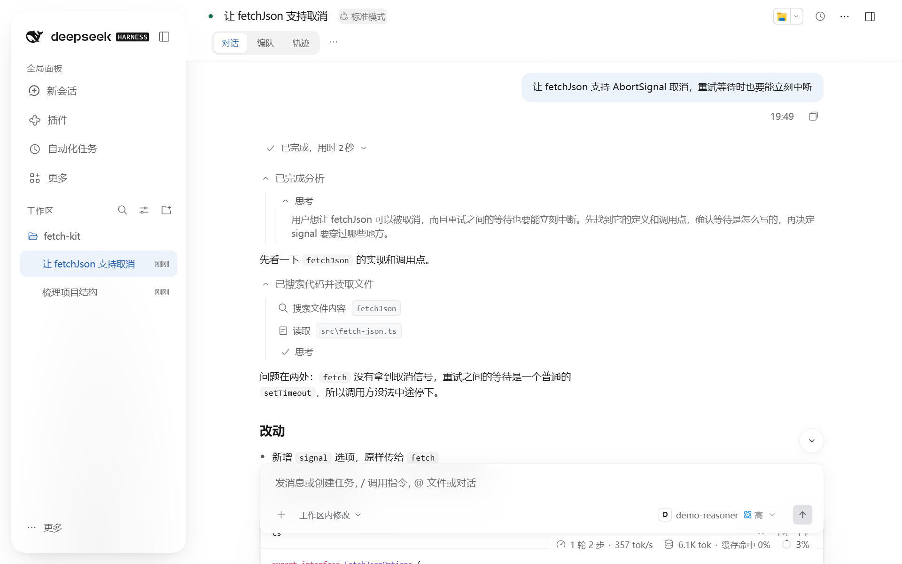
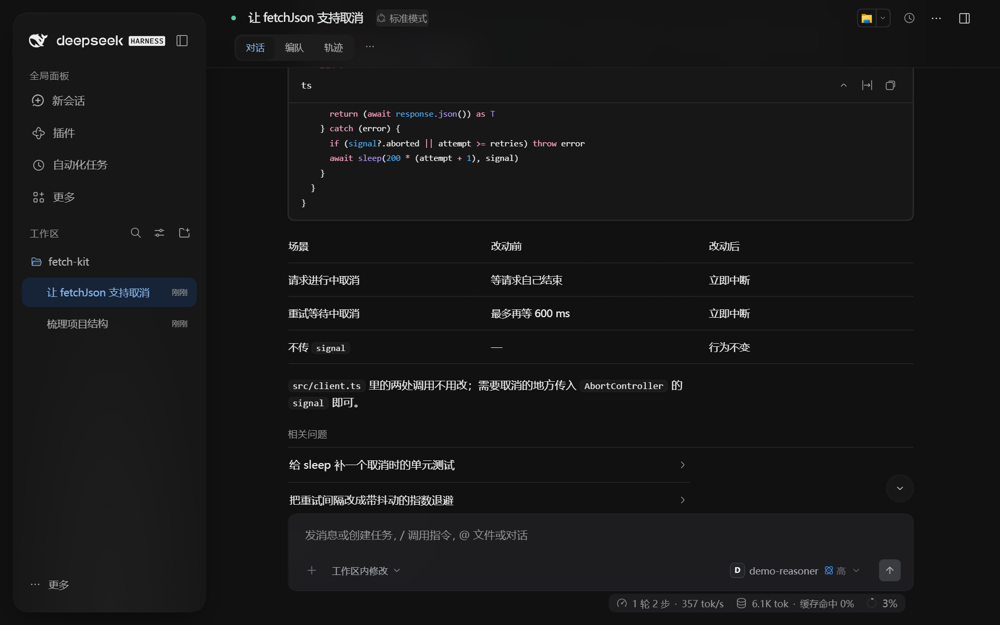

# DSH Modern UI

中文 · [English](README.en.md)

给官方 **DeepSeek Harness（DSH）** 用的现代化 Web 界面插件，npm 包名 [`@iroha1145/dsh-modern-ui`](https://www.npmjs.com/package/@iroha1145/dsh-modern-ui)。不修改官方后端，随时可以切回官方界面。

<p>
  
  
</p>

## 安装

前提：

- 已装好官方 DSH，版本在 `0.2.1-rc.2` 及以后的 0.2 系列（已验证 rc.2、rc.3、rc.4，见[兼容矩阵](docs/compatibility.md)）。
- `pnpm` 在 PATH 上（`dsh plugin` 会调用它）。
- web profile 至少启动过一次，没有的话先运行 `dsh web`。

```bash
dsh plugin --profile web add @iroha1145/dsh-modern-ui
```

装好后刷新浏览器。

- 官方聊天界面的偏好（工作过程视图、折叠时机、用量展示等）不会搬过来，在「设置 → 通用」里重新选即可。官方原有设置不会被删，切回官方界面后照旧生效。
- 离线安装：从 [Releases](https://github.com/iroha1145/DSH-Modern-UI/releases) 下载 `modern-ui.tgz`，执行 `dsh plugin --profile web add ./modern-ui.tgz`。
- 不支持从 Git 地址安装。

## 切回官方界面

```bash
dsh plugin --profile web remove @iroha1145/dsh-modern-ui
```

也可以在「插件管理」里停用**整个** `@iroha1145/dsh-modern-ui` 再刷新。只停用里面的 `modern-ui` 条目不够。

## 官方 Desktop（部分支持）

1. 先打开一次 Desktop，再完全退出。
2. 用 **Desktop 自带的 `dsh`** 安装（菜单「应用 → 管理 dsh 命令…」把它加入终端）：
   ```bash
   dsh plugin --profile desktop add @iroha1145/dsh-modern-ui
   ```
3. 重新打开 Desktop。卸载把 `add` 换成 `remove`，同样要重启 Desktop。

启用后 Desktop 的首次引导会记为已跳过。原生文件拖出、多窗口、「Open In…」等原生能力还没验证，见 [Desktop 验收记录](docs/compatibility/desktop-0.2.1-rc.5.md)。

## 主要功能

- 对话：思考过程分组折叠、消息时间轴导航、代码块与 Markdown 预览折叠。
- 输入：选中文字快速引用、图片原图粘贴和拖拽、命令与文件引用胶囊。
- 卡片：基于 [OpenUI](https://github.com/thesysdev/openui) 的交互组件（`openui-lang` 代码块：卡片、流程图、图表、表格、能计算的小工具）、`followups` 追问建议、子代理编队视图、工具调用卡片。
- 模型选择卡片，可设置推理强度。
- 8 种界面语言，多套明暗主题。

「回答可视化组件」默认不改模型提示词；在「设置 → 通用」开启后，会向模型追加约 30 KB（约 7,000 个词元）提示词，让回答使用卡片、流程图等组件。组件需要 Chrome/Edge 111、Safari 16.2、Firefox 121 或更新的浏览器。

可选：如果你有 [TypeSafe](https://typesafe.ai) 的 Jev 访问权限，把密钥放进环境变量或 DSH 的 `.env`（变量名 `TYPESAFE_API_KEY`），并打开「回答可视化组件」。之后每条新消息会先请 Jev 判断最适合的呈现方式（纯文字、表格、卡片、步骤、图表、流程图、绘图或计算器），再把判断作为一行提示交给回答模型。没有密钥、Jev 超时或出错时不加提示，一切照常。

## 可选：一键隔离安装

适合本机没有 DSH，或想让 Modern UI 用独立的程序目录和数据目录。从 [Releases](https://github.com/iroha1145/DSH-Modern-UI/releases) 下载 `installer.zip`，解压后进入 `plugin-preview`：

```bash
sh ./install.sh '/path/to/program' '/path/to/data'
```

Windows 用 `powershell.exe -NoProfile -ExecutionPolicy Bypass -File ./install.ps1 -Root 'D:/DSH-Modern/program' -DataHome 'D:/DSH-Modern/data'`。

安装器会准备私有的 Node、pnpm 和官方后端，安装前备份数据目录，并迁移官方聊天偏好。基于已有 DSH 安装、附带社区插件、回滚和卸载等做法见[安装详情](docs/install.md)。

## 常见问题

- **装好后界面没变**：先刷新浏览器（Desktop 要重启）。再确认装进了正在运行的 profile（`dsh web` 用 `web`，Desktop 用 `desktop`），并且「插件管理」里整个 bundle 已启用。
- **能和社区插件一起用吗**：已验证 `dsh-context@0.75.1` 和 `dsh-better-sidebar@0.28.0`。通过官方公开槽位扩展的插件一般能共存；依赖官方内部结构、或自带一套聊天或布局界面的插件不保证。
- **官方 DSH 升级后失效**：先看[兼容矩阵](docs/compatibility.md)。每天的自动测试发现新版本不兼容时，会开一个 `upstream: <版本> 兼容失败` 的 [issue](https://github.com/iroha1145/DSH-Modern-UI/issues)。

## 本地构建

需要 Node.js 24：

```bash
npm ci --ignore-scripts
npm run build      # 编译到 packages/modern-ui/lib
npm run preview    # 生成 .artifacts/plugin-preview（tgz 与安装器）
```

参与开发见 [CONTRIBUTING.md](CONTRIBUTING.md)，版本变化见 [CHANGELOG.md](CHANGELOG.md)。

## 文档

[安装详情](docs/install.md) · [兼容矩阵](docs/compatibility.md) · [架构](docs/architecture.md) · [旧数据迁移](docs/data-migration.md) · [宿主兼容层](docs/host-compat.md)

## License

[MIT](LICENSE)。从 DeepSeek Harness 派生的部分保留上游版权，见 [`THIRD_PARTY_NOTICES.md`](packages/modern-ui/THIRD_PARTY_NOTICES.md)。
