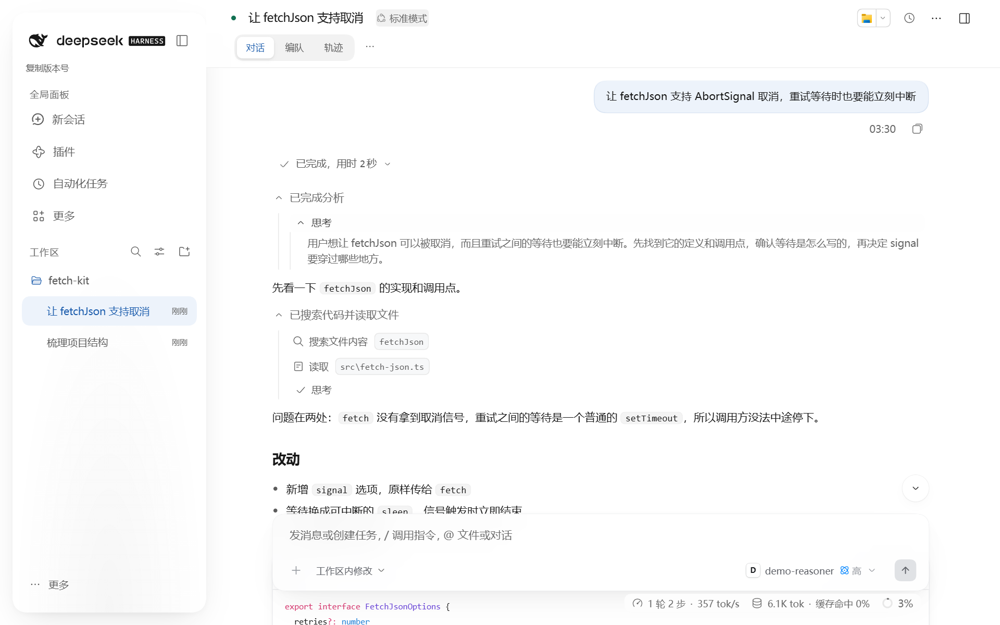
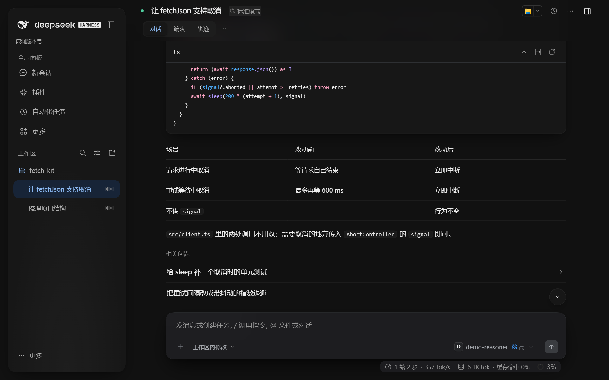

# DSH Modern UI

中文 · [English](README.en.md)

给官方 **DeepSeek Harness（DSH）** 打造的一套更清爽、更顺手的现代化界面插件（npm 包名：[`@iroha1145/dsh-modern-ui`](https://www.npmjs.com/package/@iroha1145/dsh-modern-ui)）。

它**只升级界面外观与交互体验**，不改动官方底层程序，也不会动你的历史对话和原有配置——装上刷新就能用，随时可以一键切回官方原版界面。

<p>
  
  
</p>

---

## ✨ 有什么功能

- **阅读更清爽，长对话不迷路**
  - **思考过程自动收纳**：AI 的长篇思考过程自动分组折叠，不刷屏；配合官方翻译插件可直接对照查看译文。
  - **问答时间轴与自由调宽**：右侧提供对话轮次导航，长文秒定位；支持「阅读 / 标准 / 宽屏」模式，也可直接拖动两侧边缘自定义页面宽度。
  - **长代码与文档一键折叠**：超长代码块、代码修改对比（Diff）、数学公式以及侧边栏文档/方案预览均支持折叠与展开。
- **把文字回答变成可交互卡片**
  - **可视化小组件**：开启后，AI 可直接用图表（柱状图、折线图、饼图、散点图，可展开查看原始数据表）、流程图、对比表格、步骤条、闪卡甚至可拖动滑块的小计算器来回答问题。
  - **边查边答 & 智能追问**：复杂任务可先交出阶段性成果，不必干等最后一步；回答末尾附带推荐追问，点一下即可接着聊。
- **输入与选模型更顺手**
  - **划词引用与原图直传**：鼠标选中聊天里的任意文字即可一键带引用追问；支持截图粘贴、原图拖入输入框或拖出保存；AI 回复途中可继续输入下一条消息排队发送。
  - **模型与思考强度面板**：直观切换模型与思考深度档位，并在输入框旁自动收纳第三方模型插件提供的专属开关（如上下文长度、极速模式等）。
- **工具调用与多智能体进度一目了然**
  - **清晰的过程卡片**：终端命令、文件读写、网页搜索、待办清单以及 AI 向你发起的多选提问/方案确认，全部以独立卡片清晰展示。
  - **子智能体「编队」视图**：当主对话派出多个子助手协同干活时，可在顶部切换到「编队」视图，像看组织架构图一样查看每个子任务的实时状态并随时点开详情。
- **多语言、多主题与手机端适配**
  - 内置 **8 种语言**（中、英、日、西、法、德、俄、葡）与**多套明暗主题**；针对手机窄屏专门重排了抽屉侧栏、输入框与全屏设置页，并在插件市场内支持直接阅读完整图文说明。

---

## 🚀 如何安装（三选一）

### 方式一：已经装好官方 DSH 网页版（最推荐）

> **准备条件**：已安装官方 DSH（`0.2.1-rc.2` 及以上的 `0.2` 系列版本）和 `pnpm`，且至少启动过一次 `dsh web`。

1. 打开终端，执行这一行命令：
   ```bash
   dsh plugin --profile web add @iroha1145/dsh-modern-ui
   ```
2. **刷新浏览器页面**，新界面即可生效。

- **离线安装**：从 [Releases](https://github.com/iroha1145/DSH-Modern-UI/releases) 下载 `modern-ui.tgz`，运行 `dsh plugin --profile web add ./modern-ui.tgz`（不支持直接用 Git 仓库地址安装）。

### 方式二：电脑还没装 DSH，或想单独隔离安装（一键包）

适合零基础新用户，或希望程序与数据都放在独立文件夹、不影响电脑现有环境的用户：

1. 前往 [Releases](https://github.com/iroha1145/DSH-Modern-UI/releases) 下载 `installer.zip` 并解压，进入解压后的 `plugin-preview` 文件夹。
2. 执行安装脚本（把路径换成你想存放的空文件夹，安装器会自动配齐运行环境并备份数据）：
   - **Windows（PowerShell）**：
     ```powershell
     powershell.exe -NoProfile -ExecutionPolicy Bypass -File ./install.ps1 -Root 'D:/DSH-Modern/program' -DataHome 'D:/DSH-Modern/data'
     ```
   - **macOS / Linux**：
     ```bash
     sh ./install.sh '/path/to/program' '/path/to/data'
     ```

更多进阶用法（复用已有后端、回滚、迁移配置等）见[安装详情](docs/install.md)。

### 方式三：官方桌面客户端 Desktop（部分支持）

1. 先打开一次官方 Desktop，然后**完全退出**。
2. 在 Desktop 菜单「应用 → 管理 dsh 命令…」中将自带的 `dsh` 加入终端，然后执行：
   ```bash
   dsh plugin --profile desktop add @iroha1145/dsh-modern-ui
   ```
3. 重新打开 Desktop 即可。（注：桌面版首次引导会自动跳过，多窗口、原生文件拖出等桌面专有能力仍在逐步适配，详见 [Desktop 验收记录](docs/compatibility/desktop-0.2.1-rc.5.md)。）

---

## 💡 首次使用小贴士

- **想让 AI 画图表和交互卡片？**
  安装后默认不改动模型提示词；请打开左下角 **「设置 → 通用」**，开启 **「回答可视化组件」**（会向模型附加组件使用说明；需要 Chrome/Edge 111+、Safari 16.2+ 或 Firefox 121+ 浏览器）。同一页还可以按需开启 **「分段交付成果」**；如果你有 [TypeSafe](https://typesafe.ai) 的 `TYPESAFE_API_KEY`，也可以在同一页填入以启用可选的「Jev 呈现建议」。
- **找不到原来的界面设置？**
  用命令行直接安装时，官方原有的界面设置会原封不动保留给原版界面使用；你可以在 Modern UI 的「设置 → 通用 / 外观」里重新选一次喜欢的主题、语言和折叠方式。

---

## 🔄 切回原版界面或卸载

- **临时切回官方界面**：打开「插件管理」，关闭**整个 `@iroha1145/dsh-modern-ui` 插件包**（注意不要只关里面的单个子项），然后刷新浏览器即可恢复原版界面。
- **彻底卸载**：在终端运行以下命令后刷新浏览器（桌面版把 `web` 换成 `desktop` 并重启客户端）：
  ```bash
  dsh plugin --profile web remove @iroha1145/dsh-modern-ui
  ```

---

## ❓ 常见问题

- **装完之后界面没变化？**
  请先刷新浏览器页面（桌面版需完全退出重开）；若仍未生效，请检查安装命令里的 `--profile` 是否与你当前运行的一致（网页版为 `web`，桌面版为 `desktop`），并确认「插件管理」里整个 `@iroha1145/dsh-modern-ui` 处于启用状态。
- **能和其他社区插件一起用吗？**
  按官方标准扩展接口开发的插件通常都能共存（已完整验证 `dsh-context@0.75.1` 与 `dsh-better-sidebar@0.28.0`）。但如果另一个插件也要整体替换聊天或页面主布局，则会产生冲突。
- **官方 DSH 更新后还能用吗？**
  仓库每天会自动检测官方新版本兼容性，遇到不兼容会自动创建 `upstream` 提醒 [Issue](https://github.com/iroha1145/DSH-Modern-UI/issues)；升级前可先查看[兼容矩阵](docs/compatibility.md)。

---

## 🛠️ 本地构建（开发者）

需要 Node.js 24：

```bash
npm ci --ignore-scripts
npm run build      # 编译插件到 packages/modern-ui/lib
npm run preview    # 生成离线包与一键安装器到 .artifacts/plugin-preview
```

参与开发请参阅 [CONTRIBUTING.md](CONTRIBUTING.md)，各版本详细改动见 [CHANGELOG.md](CHANGELOG.md)。

## 📚 详细文档

[安装详情](docs/install.md) · [兼容矩阵](docs/compatibility.md) · [系统架构](docs/architecture.md) · [旧数据迁移](docs/data-migration.md) · [宿主兼容层](docs/host-compat.md)

## License

[MIT](LICENSE)。从 DeepSeek Harness 派生的部分保留上游版权，详见 [`THIRD_PARTY_NOTICES.md`](packages/modern-ui/THIRD_PARTY_NOTICES.md)。

## 友情链接

- [LINUX DO](https://linux.do/)
