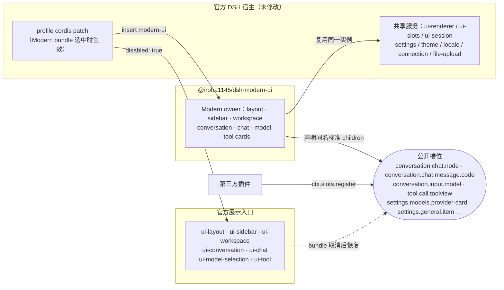

# Modern UI 插件映射与验收

消费宿主是未经修改的官方 `@deepseek-ai/dsh@0.2.1-rc.4`。展示基线是 upstream `22ddee3792402c3e70ec5f86a63c3e3e895a2f60` 加 Modern UI `a9f4c370` 的固定补丁；适配当前 Host 的客户端目录与 HTTP provider 另以实际 rc.4 npm artifact 为依据。逐文件来源、原始字节摘要和适配后摘要见 `packages/modern-ui/provenance.json`。

## UI owner 和共享服务

bundle 明确停用 `ui-layout`、`ui-sidebar`、`ui-workspace`、`ui-conversation`、`ui-chat`、`ui-model-selection`、`ui-tool` 七个展示入口，使用独立包中的对应 owner。各 owner 声明原标准 children；附件、工具、模型标签、插件管理及社区贡献继续使用公开槽位。

React、React DOM、Cordis、client-store、ui-slots 和官方 ui-primitives 共享外部实例。Modern primitives 使用独立名称，复用官方弹层栈、pointer modality 和 composition observer。没有覆盖模块表、原型或官方文件。Manifest inject 仅描述实际存在的模块到达边；不能依赖已停用的展示模块。

官方 Host/session/Remote、命令执行、配置、上传、插件管理、模型目录、locale 和 theme 保留。插件只打包模型展示需要的客户端 catalog/directory/resolver，选择仍调用同一官方 API，状态仍来自原 Session projection。Conversation 复用公开 Host schema/apply，偏好写入 `modern-ui`；安装器从实际生效的旧配置迁移并保存回执。

## 接管关系图（给第三方插件作者）

- **官方 owner 被禁用**：bundle 的 [`cordis.patch.yml`](../packages/modern-ui/cordis.patch.yml) 把七个官方展示入口标为 `disabled: true`。原条目和配置留在基础 profile 里，取消或移除整个 bundle 后原样恢复；只停用 `modern-ui` 单个条目不会恢复它们。
- **Modern owner 接管**：同一份 patch 插入 `modern-ui` 条目，客户端挂载对应的 Modern owner。宿主、会话、命令、配置、上传和插件管理仍由官方服务提供，React、Cordis、client-store 和 ui-slots 用的是宿主的同一实例。
- **slot 注入**：Modern owner 声明与官方 owner 同名的标准槽位，所以第三方插件按官方方式 `ctx.slots.register` 的贡献在两套界面里都会出现，例如模型标签、工具详情视图、代码块渲染器、设置项和 provider 卡片。

给插件作者的约定：

- 只通过公开槽位和公开 store / controller 贡献界面，不要依赖 Modern 的 DOM 结构或 CSS 类名。它们随 vendor 同步变化，不属于兼容承诺。
- `modern.*` 前缀的槽位（如 `modern.workspace.toast`）是本插件内部用的，不对外承诺。
- 要另带一整套聊天或布局 owner 的插件会和本 bundle 争同一组入口，需要单独评审。已验证可共存的组合见[兼容矩阵](compatibility.md)。
- 自测时分别在启用和停用 Modern bundle 两种状态下各跑一遍，确认贡献在官方界面和 Modern 界面里都出现。

## 展示映射

1. 外壳、侧栏、工作区、手机 drawer 和宽度状态使用旧补丁展示，动作由原控制器执行；没有第二份工作区或会话状态。
2. 唯一 Conversation owner 保留输入、附件、排队、停止和视图显隐；浏览器原图服务负责原始字节和应用内转移，普通 file-upload 保留。
3. Chat owner 保留消息、推理分组、运行状态行、时间轴、代码折叠、引用、工具过程及 steering；新增选择文字引用进入原输入队列。
4. 模型选择器渲染标准 `conversation.input.model.label`，官方与第三方标签直接贡献。设置页通过 `settings.models.provider-card` 添加目录模型推理声明，支持 API 值、Off、继承列表和 revision 冲突。
5. Tool owner 提供 generic/MCP/自动拒绝 fallback 与标准详情、图片等子槽，保留第三方具体工具视图优先级；工具执行器仍为官方。
6. 回答组件、Followups、编队、翻译和多语言保留。回答组件用 OpenUI 渲染器（`@openuidev/react-lang`）把 `openui-lang` 代码块画成页面内组件，只有 `HtmlView` 在两层无网络沙箱里运行脚本；翻译继续使用官方 Remote/Controller，不承诺把原私有 reasoning children 的所有第三方贡献自动透传。
7. 文件 Markdown、Plan、提问和预设指南使用可折叠代码块。提问与预设通过公开 face/store 替换展示，控制器不复制。`dsh-better-sidebar@0.28.0` 的编辑器由限定 DOM 适配增加折叠，并保留社区编辑、复制、导航和自有渲染。
8. Installed 与 Discover 恢复本地化长文档、README、仓库回退、相对图片和重试，使用独立受鉴权 Host 路由与官方库存；插件启停/安装仍交由官方管理器。
9. 主题通过公开 override layer，官方控件与菜单通过限定到 rc.4 的样式适配；启动和失败页通过公开 `webserver/index-inject` 注入样式。样式和监听器随 owner 卸载释放。
10. 会话联网按钮、`/web on|off` 与旧 `web/search` 策略已取消。官方搜索/抓取工具、provider 配置、结果卡与来源引用保留。

## 验证入口

本轮实现、独立审查和剩余边界见 [迁移缺口补齐记录](history/migration-parity-20261028.md)。`npm run build` 检查 TypeScript、共享 runtime import 边界及实际打包许可证；`npm test` 覆盖真实官方 renderer、SlotCore、HostConnectionService、配置组合、数据和启动生命周期。

`tests/compat/run.mjs` 在仓库外建立独立消费者，其中 `tests/compat/browser.mjs` 在官方 Host 上用本地确定性模型夹具检查插件 active 与共享模块身份、模型选择与推理档位、方案动作、消息发送与流式、工具过程与答案区、原样复制与答案导航、附件、停止生成，以及设置和历史在 Host 重启后保留。社区插件不再默认安装；兼容回归把已验证的社区组合作为候选装上，额外验收侧栏文件读取、编辑保存与 Markdown 折叠和真实会话统计。`tests/compat/npm-install.e2e.mjs` 单独验收 `dsh plugin add` 一行安装。

消费 CI 不 checkout，只使用预编译包、薄安装器和官方发布资产；官方文件来源/摘要、实际运行能力和浏览器分别验收。平台结果以匹配提交的 CI 为准。旧 run id、包摘要和测试数量在 [首轮记录](history/plugin-migration.md) 保留为历史，不能视为当前包验收。

## 边界

切换整个 Modern UI bundle 后需刷新页面；只停用 `modern-ui` 单 entry 不会恢复被 bundle 停用的官方 owner。含显式 Host 兼容绑定时，移除包前还要恢复这些配置，见 [安装文档](install.md)。

本轮浏览器原图链不包含 rc.4 缺失的原生 Electron 拖出桥。真实触屏、WebKit、Electron 多窗口、全部输入法/辅助技术和第三方私有组件组合没有全面验收。窄视口鼠标模拟不等于真机触屏，功能保留也不等于所有状态逐像素一致。官方 Desktop 内的逐项结论见 [Desktop 验收记录](compatibility/desktop-0.2.1-rc.5.md)。
