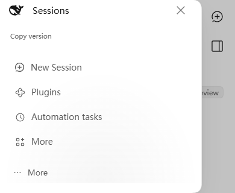
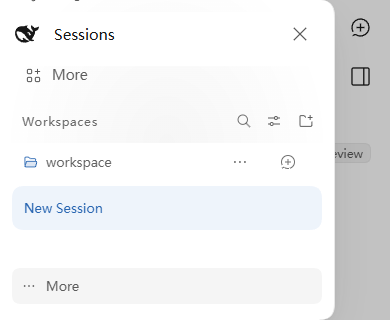

# 前端审计核验与整改（2026-11-11）

本次核验基于 `8102dee743c0e35dae550c3a3795db64b236faab`（0.1.14），逐项处理原报告 F-01 至 F-38，并参考后续独立核验意见。报告中的示例、严重度和修复建议均重新对照当前源码、已安装的官方宿主和有限运行实验；“部分成立”不表示接受同一条目中的全部推断。

输入材料的 SHA-256：

- `DSH-Modern-UI-前端全方位审计报告.md`：`4aa2a2bf0edefaeaa72bcf8900fe9b2a32cbd7788d9865ba63c78171804a6c6e`。
- `DSH-Modern-UI-Audit-Verification-2026-11-11.md`：`9df4920f269164b7979c42989456b61a3bdf946e77f8a13d879670b4c08c9b3e`。

## 逐项结论

| 条目 | 核验及最终处理 |
| --- | --- |
| F-01 | **确认并修复预算遗漏。** 引用值转 literal AST、共享子图的展开计量、隐式文字转换、比较和序列化补上操作前约束。进一步发现 Query/Mutation 的 AST visitor 重访共享节点造成指数放大，改为每次遍历按对象身份去重，保留前序和 visitor 新增子节点的行为，并计入节点上限。没有通过让浏览器 OOM 来证明问题。 |
| F-02 | **防御改进，原 Critical 可达性不成立。** `reasoningFragments` 将限制归一化为有限正整数；0.5 的旧实现会在有界 Worker 中耗尽其 32 MB heap。但官方配置 schema 已要求自然数且最小为 2，不能将内部函数参数反例当成普通设置入口的远程崩溃。保留限制为 1 的既有内部行为。 |
| F-03 | **确认并修复预检与渲染不一致。** 传输协议包装经过词法规范化，预检、状态引用检测与 Renderer 使用同一程序；拒绝藏在其他协议段的代码，同时保留字符串中的合法标记和流式未完成字符串。原来的运行时预算与状态回调并非全部失效。 |
| F-04 | **确认局部 SVG 越界，修复并缩窄安全说明。** 正确的 `Pressable([Svg(...)], action)` 可以让透明 Rect 命中前一消息区域；同一夹具中 composer 仍受层叠保护。仅裁剪 SVG viewport，保留 Popover portal、原生 Select、阴影和焦点环。未证实全屏劫持，也未把所有 DOM 组件宣称为严格像素隔离。 |
| F-05 | **确认并修复。** 转换后的字符串 Infinity 不再进入图表计算；有限 ±1e308 的 domain、ticks、坐标、饼图比例及堆积面积跨零插值避免溢出。堆叠总和不可表示时显示说明并自动展开完整数据表。MIN_VALUE、单个 1e308 及 Range 扩展包含 0 的原有行为保持；不是所有报告中的极值例子都失败。 |
| F-06 | **确认并修复。** 失败正文、引用、引用片段和运行时附件作为完整恢复记录，与新草稿隔离；仅原本未修改的空草稿自动恢复，其余显式恢复/丢弃。刷新保留语义备份和缺失附件提示，不持久化 Blob，不自动重发。损坏 JSON、安全限制、转存失败、对应重试成功和附件所有权均有回归。见下文恢复边界。 |
| F-07 | **键盘合同问题确认并修复；普通行导致全局永久锁死未证实。** 父菜单尊重子行 `defaultPrevented` 和自管键盘字段，鼠标打开后首 Tab 进入首个控件，纯输入行与边缘 Tab 能正常退出。实际宿主先用每个 slot entry 的 SlotErrorBoundary 隔离普通组件异常，直接抛错的假行不等价于该产品路径，因此未为其添加不必要的模型切换重挂载。 |
| F-08 | **瞬时读取失败问题确认并修复，另两项不成立。** 已有 Codex 能力快照在临时传输失败时保留为只读，重新打开可重试；明确拒绝/不兼容/不合法回执仍清除。reset 使旧在途回执失效，未使用该能力时不多发请求。真实目录重载可恢复入口，未证实永久重连死锁；3.2.9 更新回执是完整 status，不盲目合并旧 writable。 |
| F-09 | **仅补指针归属防御。** 活跃拖拽忽略另一指针的 down/up/cancel/lostcapture。官方子代理嵌入未注入第二个 WidthControls，报告的主会话/侧栏双实例全局 editing 路径不成立；未改变该状态所有权。真实鼠标加合成第二指针终止事件通过，不等同实体多指测试。 |
| F-10 | **优化成立，原体积和收益需更正。** 保留单文件 CJS、全量动态 Lucide、语法语言、Zod；只用 UTF8 输出及共享 conversation 字典减少冗余。受控同输入净收益为 776,743 B，gzip 52,758 B；没有按估算相加承诺 2 MB，也不以删功能达到任意的 8 MB 目标。 |
| F-11 | **成本来源部分成立，未证实每帧强制重排或全树每键刷新。** Menu 缓存尺寸并由 ResizeObserver 更新，保留能跟随祖先位移的 anchor rAF。37 帧中尺寸读取 74→0，idle LayoutCount 两版均为 0；流式内容更新两版均为 37。模型扩展位置轮询保留。10 次语义编辑对应 10 次完整合同发布/持久化，纯选区变化为 0；InputBar ResizeObserver 夹具收敛，不机械重写算法。 |
| F-12 | **确认并修复。** Modal 限高、内容滚动和 footer 可达；安装确认按钮使用官方约定的 `data-modal-autofocus`，关闭恢复实际触发器。真实 Modal 在 320px 高度和模拟 200% CSS zoom 下通过；未将所有实际弹窗、所有浏览器缩放一并宣称已覆盖。 |
| F-13 | **确认可用空间问题并修复公共组件合同。** 根菜单翻转，子菜单独立 portal、左右翻转及高度封顶，长父列表仍可滚动；左右键、逐层 Escape、hover 跨隙及外点有回归。子菜单属于公开能力，未找到原版本仓自带的 submenu 数据入口。引用浮层只扣实际 scrollport 顶部遮挡 inset，避免与 padding 重复扣减。 |
| F-14 | **部分确认并修复。** ModelSelect 采用 visualViewport 尺寸/偏移，并将 coarse pointer 搜索输入设为 16px。真实 rc.4 移动侧栏在 390×320、390×260 的会话区域确实为 0，搜索不可达；移动抽屉整体可滚动、浏览区域最小 160px，关闭入口 sticky。修后 list 为 118px，搜索/会话/底部菜单实际可操作，30 次 Tab 焦点未被头部遮挡。真实 641px 为 sidebar 68 / center 573 / right 0，原报告默认 center 281 不成立；640 内外保持同一 narrow 状态是既有 1024 断点设计。 |
| F-15 | **实际 IME 和边缘滚轮问题确认并修复。** InlineEditor 先判断组合态再消费 Escape；ModelSelect、工作区搜索和重命名复用官方 observeComposition。草稿边缘放过 Ctrl/Meta 缩放并按 deltaMode 换算滚动。WorkspaceBrowser 原处理的是 Escape，不是报告所说的 Enter 提交。未测试实体 Safari/系统 IME。 |
| F-16 | **部分确认，按当前色值修复。** 调整 bui 说明色、亮色绿色/橙色、5 个亮色 Shiki token，以及实际低对比的 ANSI 蓝/青/紫色；68 个明确前景/背景组合实测均不低于 4.5。`--ink-3` 不等于 `--bui-ink-3`；Tooltip 白字对暗底原本合格。两份报告都误判 SGR 37：当前 Anser 2.3.5 实际输出 255,255,255，已映射到主题文字色。普通 dim 实际 opacity 为 0.7，也通过所测底色。OpenUI 半透明背景改为继承前景，不宣称任意透明色自动满足 AA。 |
| F-17 | **真实译义错误修复。** 校正年/秒/重试单位、星期日、Bing、LLM、Plan、默认值及相关运行/排序等文本；保留占位符。显式 before/after 清单记录 89 项增改，另同步 legacy chat/workspace 的 30 个对应值。原 391/395-key hashes 不变，经逆向恢复已批准修正核验无旁及。问题是显示译文，不是持久化时间数据损坏。 |
| F-18 | **拆分处理。** 归档推送中断新建会话导航和取消原生拖拽仍写排序均已复现并修复。价格是手动刷新与保存重叠的一次 revision 冲突，非每 30 秒轮询或永久自锁；等待本地价格写入后重新核对目标/权限/revision。同一 reasoning 行外部修改仍拒绝，仅无关行变更可安全更新 revision。QuestionFlow 原倒计时跨题链不成立，保留迟到回执与 hide 失败反馈防御；实际 Host 拒绝空问题批次，不为不可达空数组另造 UI。 |
| F-19 | **生命周期限制确认，修正文档而不声称沙箱逃逸。** document.open/write/close 的第二次 load 会被结束；不 close 的同文档重写可破坏桥接，并用作者环境里的消息维持存活，独立探针超过 6.2 秒仍存在。但 parent.document 和 fetch 仍被挡住。随机 token/窗口来源核验本来存在，不能在同一受作者控制环境加可读 token 后声称获得强隔离。SEC-R01 继续开放。 |
| F-20 | **实际边界一致性修复。** space、Carousel gap、Grid 尺寸经统一有限/4000px 约束；颜色、圆角和 SVG transform 名只查自有属性。没有报告中的 BORDER/SHADOW 字典或 Grid.rowGap。加入 `src()` 拦截是纵深防御，所测 Edge 157 当前不支持该 CSS 函数，未确认已有网络加载漏洞。 |
| F-21 | **部分改进，崩溃指控不成立。** 原 async catch 已收住编码/解码拒绝。现在按 Unicode 字符截断、替换孤立代理项，坏文件名仅局部降级；SearchImage 等代码块流式结束后查询，只接受 Wikimedia 域的结果图。原本是 500ms 防抖，且自动外发已在 SECURITY 披露，不是新发现的权限逃逸。显式 Image 地址和正常非流式搜索保留。 |
| F-22 | **兼容性及尺寸边界修复。** 插件文档保留支持的 image data、blob、协议相对地址；本地包图片继续由宿主解析。文档图片重新挂载使用新 load 标识，普通远端图片 URL 不变。两条 KaTeX 渲染路径都限定 maxSize=20，保留既有 maxExpand=1000；外链汇点再检查 http(s)。失败响应原本 no-store，不能称全部失败缓存十分钟；未证实 javascript URL 执行或 KaTeX OOM。 |
| F-23 | **队列编辑重入确认并修复。** 同步入口锁阻止相同 messageId 重复 edit 请求，失败保留编辑内容。拖出 Blob 在原生 OS 异步消费者中的失败没有完成复现，未采用未经验证的 60 秒 lease，也未改 transfers 产品逻辑；现有 start/dispose 会清理活动记录，非无界监听泄漏。 |
| F-24 | **确认局部重复成本并优化。** 同一 diff 的摘要与展开内容共用 patch 结果，内容变更使缓存失效；FileMutationRow 复用不可变 block 的模型。FlatList 首屏 50、每次加 50，当前/搜索目标仍可显示，排序仍用完整列表。模型设置缓存目录/行投影并保留语言切换；未发现报告描述的不存在的两次搜索过滤。详见有界性能数据。 |
| F-25 | **仅做有证据的小改动。** OpenUI parser/schema 延迟到实际使用，移除一次约 6.48ms 的导入期构建；不宣称已证明首屏可感知提速。实际语言安装是 348 个 effect（342 字典 + 6 语言），不是独立 Fiber。语言共享前后安装中位 2.40→2.21ms；保留高亮 0ms 预热和 lazy correctness fallback，没有证据就不改其调度。 |
| F-26 | **确认并修复。** continuable 子会话的文件选择入口与图片 intake/drop 使用同一允许条件；readonly、离线、blocked 及非图片仍拒绝。没有开放所有普通文件。 |
| F-27 | **部分确认并修复。** scoped sr-only 隐藏脚注标题但保留可访问名称；隐藏 until-found 推理块抵消真实 12px gap。市场 toolbar 320px 实测 scrollWidth 524，改为换行；并不存在固定 196px 搜索宽度。短桌面长草稿实测 390px 高度下 seat 顶部 -52px，已推广既有高度约束。真实 641/700/760px 欢迎内容与输入卡中心轴差均为 0，未见所谓 20px 错位；另发现矮窗口欢迎 stack 高于可用区时顶部越界，改为 safe center，使溢出内容从滚动起点开始，宽裕时仍居中。 |
| F-28 | **缺失 token 确认并修复。** `--iui-font` 关联实际宿主字体族，让 Popover/SVG 文字简写有效。旧版所测环境继承 Arial 14px，不是所有 Select 都退回衬线；原生 Select 也不是 .iui-popover。 |
| F-29 | **主要故障反证，无产品改动。** 两次真实 installThemeStyles 的节点数为 0→13→26，卸载第一份剩 13，卸载第二份为 0；清理只删除自己创建的节点。条件菜单 token 已排除出 inline override。未机械加入共享引用计数，也未声称正则可以通用解析所有 CSS 条件。 |
| F-30 | **重绘列错位确认并修复。** 零宽组合符附到宽字符的 lead cell，不再破坏 spacer；CR、退格、擦行、Emoji variation 和 SGR 颜色有回归。终端 header/output 的透明 scrollbar border 从 2px 改为 1px，默认 5px 轨道保留 3px 可见滑块。普通不重绘文本原本正常。 |
| F-31 | **修复 Toast；其他主张缩窄。** 悬停可操作 Toast 或聚焦动作时暂停剩余时间和淡出，离开后继续；动作加下划线。实际 ToolRow 在 Chromium AX 中保留文件 button/URL link，文件 Enter 不切换展开；没有仅凭嵌套 role 重构。宽屏 turn rail 的键盘 focus 可显示预览，触控可导航；小于 900px 的 rail 本来隐藏，无强制 roving Tab 合同。未宣称全屏幕阅读器认证。 |
| F-32 | **确认并修复特定样式问题。** Switch 原本已有 focus outline，但 forced-colors 下 track/thumb 同白；改系统色与边框，Menu 补强制色彩焦点。图片 shimmer 的 reduced-motion 规则原特异性不足，修后 computed animationName=none，普通模式保留。 |
| F-33 | **去重整理，不是修复现有漏注册。** 公共六语种原本由 installLanguages 注册。现在对本插件新建且拥有的语言从共享字典注册，删除单一重复 JSON row；保留第三方已有语言的所有权、原 zh/en 公共 adapter 四键，以及 chat/fileDrag 等真实消费者。真实官方 LocaleRuntime 注册/切换/撤销已验证。 |
| F-34 | **主要指控不成立，仅保留外链纵深防御。** 合法 base64 data 图标、lazy 和 no-referrer 原本存在并保留；实际市场元数据也受宿主校验。客户端外链再限定 http(s)，不把绕过宿主校验的假数据注入说成已有漏洞。 |
| F-35 | **按入口区分。** ModelSelect 原版和修复版的真实 Edge scrollbar 点击/拖动都保持打开，未改 blur。工作区搜索第一次普通 Escape 清空并消费，第二次允许父层关闭；组合输入 Escape 不触发这些动作。 |
| F-36 | **反证，无对应泄漏修复。** 当前 HtmlView 没有所述 settled Set。MessageImage 失败后不会自动重试，主动点击一次才增加一次加载；不能把显式 retry 计数称自动无限重试缓存。 |
| F-37 | **补有效回归，但不采用“0%覆盖”断言。** 新增实际 Codex store/菜单事件和错误回执测试，覆盖鼠标首 Tab、defaultPrevented、输入行、reset、瞬时失败、陈旧响应和未使用时不请求。没有覆盖率报告就不声称此前覆盖率精确为零。 |
| F-38 | **契约断言遗漏确认并修复。** mobile-settings 对实际官方 module mapping 与 CSS 增加 VOzbGW_actions；并以语言语义/占位符测试补足仅 key/hash 检查的不足。原类名未失效，不宣称当前设置动作区已坏。 |

## 恢复记录的验收边界

失败发送先保留其完整语义单位，不把旧附件追加到用户正在写的新消息。与同一条失败消息关联的重试成功才清理该备份；丢弃恢复记录不会释放当前草稿仍拥有的附件。

独立复查补出了三类持久化边界，以及一个复修遗漏：

- 自动恢复含附件消息后刷新，正文仍在，恢复记录仍显示预期附件数和缺失提示。
- active draft JSON 损坏时重建该存储对象，正文成功转存前不删除唯一备份。
- `localStorage` 属性 getter 抛 SecurityError 时，相关读取和写入均收住异常。
- 备份可写但 active draft 写入被拒绝时，不能持久化一个会把备份隐藏的“已恢复”假设。重新读取时仅在完整语义正文与实际 active 存储匹配时保留 restored；同一独立探针的可见恢复入口从 0 变为 1，用户可以再次恢复并落盘。

所有存储都不可用时仅保证本次运行的内存恢复；未把 Blob 持久化或跨设备恢复作为已实现能力。发送中的消息本身不等同已确认失败的持久恢复记录。

## PR #61–#63 复查补充

**R61-01 确认为本 PR 的附件所有权回归。** 自动恢复后的图片同时由活动草稿与失败备份持有；原工作区转移只移走活动列表，旧 scope 最终销毁仍会释放新会话使用的登记和 object URL。现在通过内部 `InputHub.transferDraft` 完成移交：先确认目标可接收并完成文件重新绑定，再解除源草稿和恢复记录对已移交附件的所有权。源文本备份保留为可显式恢复的记录，已移交图片计为需要重新附加；未移交的失败附件仍会在源 scope 销毁时释放。目标拒绝或文件重新绑定抛错时保留源所有权并回滚目标草稿；替换目标草稿也解除旧恢复标识，避免新消息误算作旧备份重试。

`workspace-attachment-ownership.test.mjs` 覆盖立即及延迟释放旧 scope 后挂载真实 InputBar，再经 ConversationController 序列化并提交到 fixture 远端，最终 prompt 仍含图片。另覆盖普通草稿最终清理、丢弃源备份、未移交的另一条失败附件、忙目标拒绝、文件绑定失败回滚及目标旧恢复标识。原有 21 项输入回归保持，新增 8 项通过。引用分配器、远端及无关视觉使用 fixture；没有把 jsdom 模块联动写成真实后端或浏览器端到端验收。

**7.2 是基线已有的最终字段转换覆盖缺口，本轮补强。** reactive 描述符经 `resolveStateField` 直接读取 `store.get(target)` 后，标量控件的 `String`/`Number` 转换不受之前 props 的展开计量约束。真实 Renderer 与 `@Set` 的有限探针以 12 层、13 个共享数组节点验证：Input、TextArea、Timer 各发生 4,095 次数组转换，Select、SegmentedControl、RadioGroup 各发生 8,190 次，原预算未触顶。探针设 128 MB heap、5 秒外部超时和 50,000 次转换上限，未做资源耗尽实验。

修复将文本与单选控件最终值收窄为字符串或有限数值，Timer 只转换数字或字符串；这六条路径的数组转换现为 0，原始共享数组仍保留在 store。表单 registry 使用同一标量投影，覆盖同一 Action 内 `Set → ToAssistant`，不读取对象 `{value: ...}` 中界面没有显示的文字。Checkbox、Slider、DatePicker 和通用数组字段的默认读取不变，数值输入联动及合法多选数组也有回归覆盖。相关字段、预算及可访问性检查 71/71 通过；这些范围不构成所有第三方组件或 DOM 分配均有完整资源计量的保证。

**合并前终审补出 Enter 键发送的自动恢复回归。** 键盘 Enter 的提交在 Lexical 的 command 更新内执行，发送后的清空是嵌套更新，要等外层更新结束才落地；它随后被计为一次编辑，使该消息的恢复标记失配。实际模块对照：main 上按钮与 Enter 发送失败后正文都回到空输入框；修复前本分支只有按钮路径自动恢复，Enter 路径输入框保持为空，正文留在失败卡片里等待手动恢复，内容没有丢失。原有回归直接调用 `shell.submit()`，没有经过键盘 command。现在带 `DRAFT_SUBMITTED_TAG` 的清空不计为编辑，没有可发送内容的 Enter 也不计；发送后真正编辑过的草稿仍然不会被旧消息覆盖。`composer-input-regressions.test.mjs` 新增 2 项，经挂载根节点的 DOM keydown 与真实 keymap 触发，修复前第 1 项失败。

#61 本轮本地全量检查通过：662 文件 lint、client/host 类型检查、334 unit + 435 audit/compat = 769 项测试；构建为 9,023,147 B / gzip 2,084,453 B、2798 个 browser inputs。最新 14 条依赖公告对应的产物暴露门禁通过。#62 的样式与 #63 的标题栏回退在各自 PR 中整合验证；此前固定提交的 760 项测试与安装矩阵属于原审计提交，不能替代本轮修改后的验证。

## 有界性能证据

以下数字来自本次 Windows / Edge 157.0.4341.42 的明确夹具，不能外推为用户整机、所有浏览器或所有会话的性能承诺。

| 范围 | 对照结果 | 实际覆盖 |
| --- | --- | --- |
| AST walker | 20 层、202 字节：4,194,330→70 次访问；约 165.6→0.21ms | 真实 runtime patched/unpatched，外部超时与 heap/访问上限；未运行无界 OOM |
| diff | 摘要 + 展开：2→1 次 structuredPatch；后续 10 次父刷新不再重建模型 | 真实 diff 算法、React 组件，修改文本会重新计算 |
| 2000 会话 flat 更新 | 中位约 22→2ms；初始节点约 16004→405 | 实际 Rows/AnimatedRows；外围图标和关闭的浮层简化，当前项及完整排序保留 |
| 2000 模型字段更新 | 中位约 40–46→3–4ms | 实际设置卡与控制器；首次全表挂载仍约 100ms |
| 语言注册 | 重复版 2.40ms，共享版 2.21ms；均 348 effects | 实际官方 LocaleRuntime，100 次，无 DOM/订阅者，不含模块加载或绘制 |
| 单文件输出 | 同输入 ASCII 9,630,574 B / gzip 2,101,657 B；UTF8 9,021,731 B / gzip 2,084,098 B | 2798 inputs；101,700 个解码字符串/模板字面量一致，不等同完整行为证明 |
| UTF8 + 会话字典去重 | 对恢复重复字典的受控版本，净省 776,743 B / gzip 52,758 B | 不相加重叠估计，不裁剪图标、语法或 Zod locale |

原始数据保存于任务的 `.artifacts/frontend-audit-20261111/`，其中 `client-charset-comparison.json`、`languages-runtime-cost.json`、`workspace-list-measurements*.json`、`theme-before.json`、`theme-after.json` 和各有限探针记录分别注明夹具。持续回归位于 `tests/audit` 与 `tests/unit`；CI 会重建实际产物及依赖暴露证据。

## 真实宿主截图

同一 rc.4、390×320 视口。旧版尝试定位搜索时会话区仍为 0；修复后可滚动到会话和底部入口，关闭按钮留在视口内。截图仅包含隔离测试数据。

| 修复前 | 修复后滚到底部 |
| --- | --- |
|  |  |

## 首轮审计的集成验证与限制

已完成针对高风险 OpenUI/恢复/模型合同、浮层与异步状态、语言所有权/字面量的独立只读复查；发现的恢复可见性遗漏已用原独立探针闭环。最终检查包括 lint、客户端/宿主类型检查、单元测试、实际构建、最新 npm audit 与构建路径暴露门禁、浏览器审计和兼容回归。

本地整合轮次为 334 项 unit、421 项 audit/compat 全通过；最后的移动抽屉和欢迎页修改另通过 4 项抽屉可达性与 11 项视口/侧栏回归，包含新增的 5 个独立用例。最终源码共有 760 个测试用例。最新依赖暴露检查仍覆盖 14 条独立公告，未知路径、受影响保留路径、未声明外置依赖均为 0；这不豁免官方宿主内部的旧依赖。

最终本地构建为 9,021,912 B / gzip 2,084,121 B，2798 个 browser inputs，均在既有预算内。真实宿主确认：1280×390 的欢迎内容顶部从 -20.859px 移至滚动区起点 44px，底部可滚到；1280×900 仍精确居中。模型 picker 选择和本地示例消息发送完成，页面异常与外部请求均为 0。测试浏览器及隔离预览进程已关闭。

真实宿主使用隔离的 rc.4 配置和本地固定模型，不读取日常用户的配置或外部模型凭据。视觉视口、强制色彩、200% CSS zoom、macOS 分支及触控事件的浏览器模拟，不替代实体 iOS/Safari IME、原生高对比度主题、多指设备、原生 OS 下载或屏幕阅读器验证。

HtmlView 的强制 CPU/内存隔离问题 **SEC-R01 继续开放**；二次 load 检测、心跳和停止按钮不能证明作者脚本无法阻塞父页面。官方宿主上游依赖公告也不由本次前端修复自动消除，继续依据 [SECURITY](../../SECURITY.md) 与实际依赖暴露报告处理。
