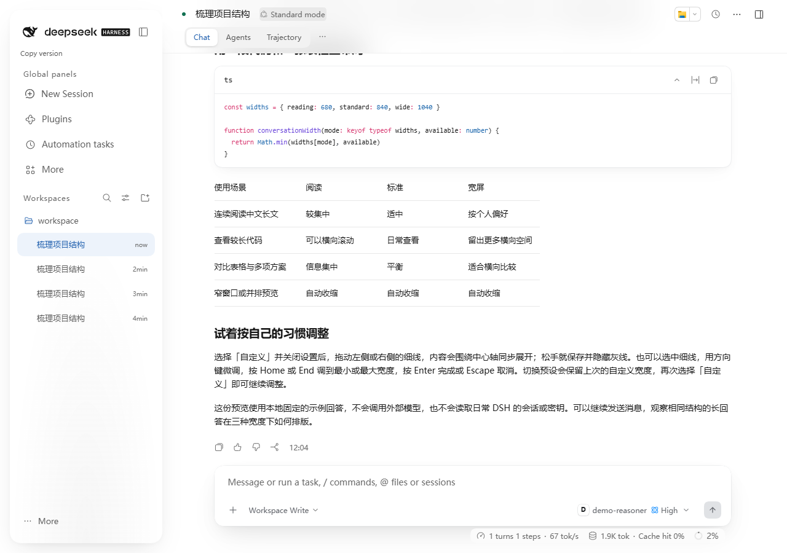
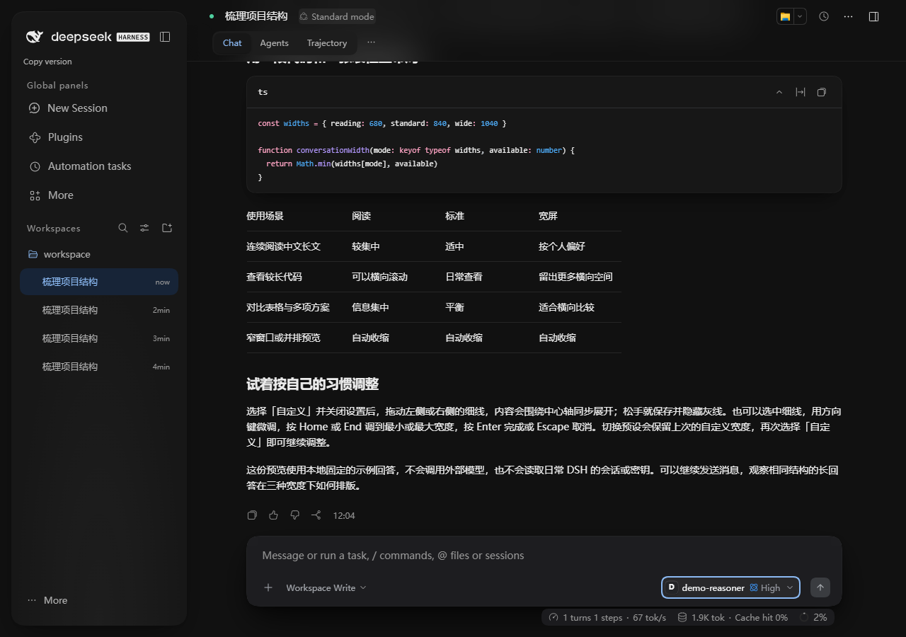

# PR #61–#63 复查修复与集成验证

2026-11-11。原审查基线为 main `8102dee`、#61 `b4d48fa`、#62 `ef2c99c`、#63 `450b03b`。本轮先修复确认问题，再用保留原提交历史的 merge 依次整合三条分支。没有用原提交的绿灯代替修改后的检查。

## 修复与保留范围

R61-01 已修复：工作区移交在目标接纳后解除源草稿和失败记录对附件的运行时所有权，旧 scope 立即或延迟销毁都不会释放目标正在使用的图片。未移交的失败附件仍会释放；接纳失败回滚；源文本备份继续可恢复。新增 8 项链路回归与原有 21 项输入测试通过，详情见[前端审计记录的复查补充](frontend-audit-20261111.md)。

报告 7.2 确认了基线已有的响应式最终值转换缺口。文本和单选控件只显示字符串或有限数值，表单读取同一投影；Timer 不再转换数组或对象。真实 Renderer/Set 的 12 层共享数组探针将 4,095/8,190 次隐式转换降到 0，保留 store 原值与合法多选数组，不执行资源耗尽载荷。Anser 版本说明更正为实际的 2.3.5。

R63-01 已修复：保留普通宽屏 active header 的双层渐隐，在无 backdrop 支持、减少透明度和强制色彩的回退条件下，同时重置 `mask-image` 与 `-webkit-mask-image`。选择器与原规则一致，正文、按钮及点击命中不被遮罩。

三方冲突位于 CHANGELOG 与来源清单。逐项保留双方记录和 OpenUI runtimePatches，原始 sourceSha256 不变；#61+#62 的 10 处组合文件与加入 #63 后的 ConversationRoot 共 11 处目标哈希重新计算。独立复查确认 SVG 裁切、图片减少动画、字体、移动搜索字号、composer 高度、Hero safe center、Switch 强制色彩、Toast 暂停/操作及对比度修复均保留。

## 实际检查

- 修复后 #61 `555f21e`：662 文件 lint、client/host 类型检查、334 unit + 435 audit/compat = **769 项**，本地与远端 PR CI 均通过。
- 整合后 #62 `758a4ed`：同样 769 项完成。首次 7 项 OpenUI 浏览器检查因 Windows 分配的 1723 端口被 Edge 拒绝而未进入页面；仅重跑这 7 项后通过，未修改产品或断言。
- 最终三方组合：663 文件 lint、client/host 类型检查、334 unit + 444 audit/compat = **778 项全通过**。包含新增的 9 项标题栏回归；此轮全套没有测试失败。
- 最终本地构建：**9,035,652 B / gzip 2,087,306 B**，2798 browser inputs，在原有 10,000,000 / 2,200,000 B 预算内。14 条公告对应的实际产物依赖暴露门禁通过，原始来源哈希和运行时补丁记录保留。

最终产品树 `2c5b30d4bf7cf3acd412e2ac38967ee58bd002ba` 经过独立静态核对；随后仅加入本记录及截图。各 PR 的新提交 CI 与最终组合安装/宿主矩阵链接在 PR 描述中维护。

## 浏览器与真实宿主

Edge 157.0.4341.42 的标题栏定向测试：原 CSS 4 项通过、5 项失败；修复后 9/9 通过。减少透明度及强制色彩下，替换底层红/蓝色块后的左下 8×8 截图完全一致，证明背景不再透出底层；普通浅/深主题继续保留渐变与 blur。640px 和 Hero 不生成该背景伪元素。

真实官方 rc.4 使用任务专用数据与本地固定模型，完成消息发送后检查生产 ModelSelect、标题栏视图菜单、Escape 回焦、浅深主题、减少透明度、强制色彩、减少动态效果和 390×320 导航关闭入口，共 9 项检查通过，页面异常及外部请求均为 0。正常 header 背景 alpha 为 0.56；减少透明度为不透明主题底色，强制色彩为 Canvas，两套 mask 和 blur 都是 none。稳定布局下模型菜单宽高与横向锚点保持不变，正常入场不超过 2px，减少动态效果时无入场动画。

浅色与深色最终截图（已滚动的固定示例回答）：

[减少透明度截图](images/pr61-63-reduced-transparency.png)和[强制色彩截图](images/pr61-63-forced-colors.png)保留完整界面证据。

## 验证边界

无 backdrop 支持分支通过替换编译后 CSS 的对应 supports gate 模拟，声明与级联保持原样。当前 Edge 即使尝试禁用该特性仍报告支持，不能将模拟称为真实不支持引擎验收。媒体偏好由浏览器仿真，未覆盖实体系统设置、Safari/Firefox、真实触屏键盘或屏幕阅读器。

附件链路使用真实业务模块和 jsdom，远端与引用分配器有 fixture；真实宿主界面检查使用本地示例模型，不代表外部账号或所有插件后端验收。截图和稳定布局菜单检查不构成流式全过程的帧稳定性证明。HtmlView 强制 CPU/内存隔离风险 SEC-R01 与官方宿主上游依赖风险继续保留，未在本轮关闭。
